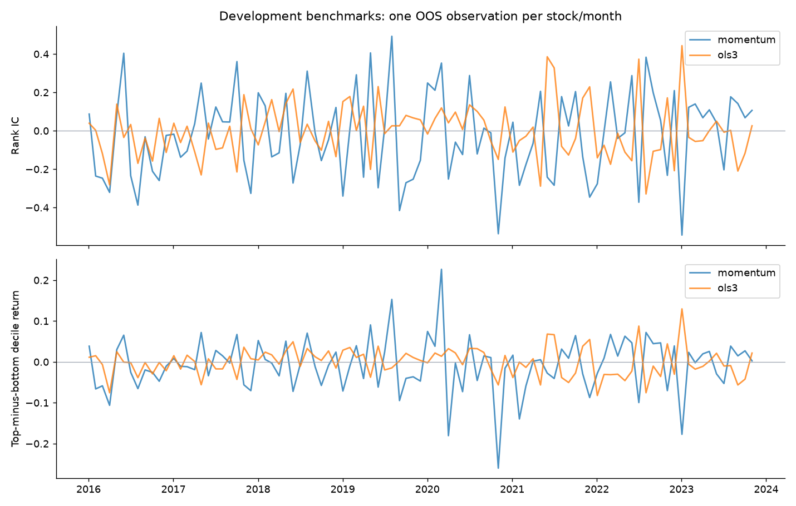
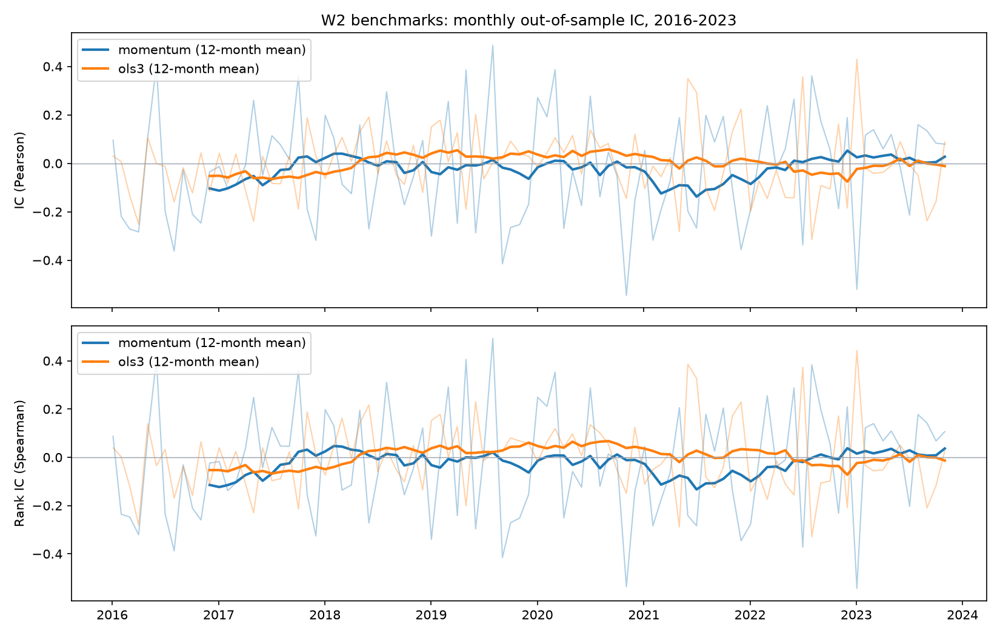

# W02 Benchmark Report

Research only. Untuned OLS-3 and pure momentum; development period only.

MLflow run ID: `d14c41498e7e43ff9494a227213ee326`. OOS evaluation starts in 2016; labels crossing 2024 are excluded. The 2015 calibration output is separate.

| model | months | mean_ic | mean_rank_ic | icir | nw_t_rank_ic | nw_t_ic | mean_hit_rate | mean_rank_hit_rate | mean_decile_spread | nw_t_decile_spread |
| --- | --- | --- | --- | --- | --- | --- | --- | --- | --- | --- |
| momentum | 95 | -0.022061 | -0.023478 | -0.10383 | -1.2773 | -1.2376 | nan | 0.49151 | -0.0073663 | -1.395 |
| ols3 | 95 | -0.0036703 | -0.00050348 | -0.0035026 | -0.037783 | -0.29165 | 0.55118 | 0.50136 | -0.00038979 | -0.11283 |

OLS-3 uses log market capitalization, positive book equity/market capitalization, and 252-minus-21-session momentum. Both models use identical scored stocks/months. Each month the untuned OLS model is refitted on past labels that have matured and passed the one-calendar-month embargo. The 12-month validation block is recorded separately; no hyperparameter is selected. Overlapping validation blocks never create duplicate OOS predictions.

ICIR is mean monthly Rank IC divided by its sample standard deviation, without annualization. Newey-West inference uses six lags and a finite-sample correction. Hit rate is defined only for the return-valued OLS forecast; a rank-only momentum score has no calibrated zero-return threshold. Decile spreads are gross, overlapping 21-session label spreads, not a costed portfolio backtest. Performance remains conditional on the documented CIK/price/fundamental coverage.

The first local experiment run is a benchmark run. No ML model or sealed-holdout evaluation is run by this command. Final hypothesis tests belong to the later one-time holdout evaluation.

## Conclusions

Neither benchmark shows statistically significant positive mean Rank IC in the 2016-2023 out-of-sample period. Momentum has a mean Rank IC of -0.023 with a Newey-West t-statistic of -1.28. OLS-3 is close to zero, at -0.0005 with a t-statistic of -0.04. Momentum is particularly weak around November 2020 and January 2023. The OLS-3 hit rate of 0.55 does not show that it ranks stocks well. Its directional accuracy also needs comparison with an always-positive forecast. These results provide the benchmarks for Week 3. H1 will be assessed later using the pre-specified test on the sealed holdout.