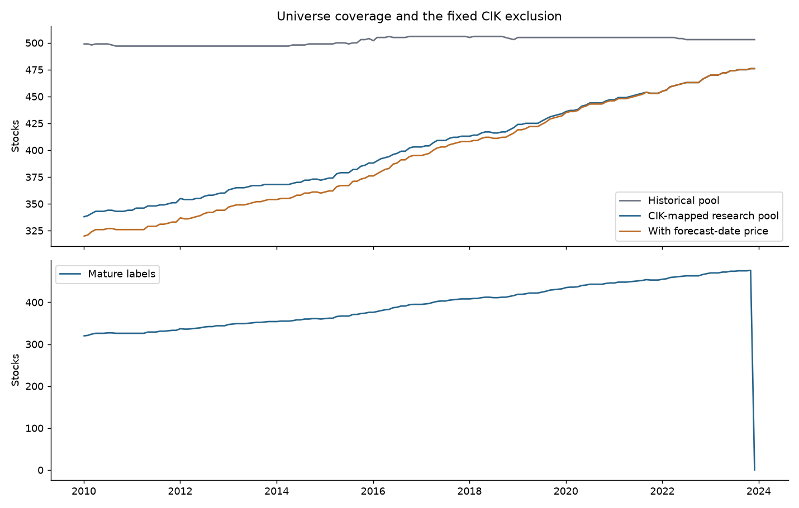
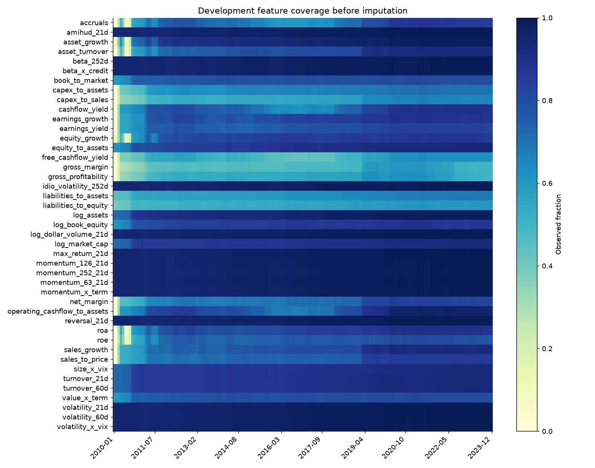

# W02 Data Quality Report

Research only. Development observations: 2010-2023. No sealed-holdout performance was calculated.

## Eligibility and selection

Companies without a CIK are excluded uniformly at every date. This uses the supplied mapping snapshot and can still select on later survival; applying the same rule does not remove that bias. No missing-CIK indicator is created. The original universe is preserved in the database.

Research rows: 67682. Mean no-CIK exclusion share: 19.77%. Missing forecast-date prices remain visible in the coverage report. They are excluded from benchmark scoring.

## Feature coverage and outliers

| feature | mean_coverage | minimum_coverage | outliers | all_missing_months |
| --- | --- | --- | --- | --- |
| accruals | 0.71218 | 0.020649 | 1111 | 0 |
| amihud_21d | 0.97589 | 0.93642 | 1504 | 0 |
| asset_growth | 0.90377 | 0.10324 | 1408 | 0 |
| asset_turnover | 0.78902 | 0.035398 | 1260 | 0 |
| beta_252d | 0.97356 | 0.94068 | 1504 | 0 |
| beta_x_credit | 0.97356 | 0.94068 | 0 | 0 |
| book_to_market | 0.78271 | 0.59763 | 1210 | 0 |
| capex_to_assets | 0.63978 | 0.032544 | 1064 | 0 |
| capex_to_sales | 0.56428 | 0.026627 | 947 | 0 |
| cashflow_yield | 0.75488 | 0.044379 | 1192 | 0 |
| earnings_growth | 0.80746 | 0.038462 | 1252 | 0 |
| earnings_yield | 0.76234 | 0.044379 | 1172 | 0 |
| equity_growth | 0.80454 | 0.12684 | 1262 | 0 |
| equity_to_assets | 0.87601 | 0.61834 | 1376 | 0 |
| free_cashflow_yield | 0.52274 | 0.026627 | 816 | 0 |
| gross_margin | 0.48578 | 0.04142 | 804 | 0 |
| gross_profitability | 0.5363 | 0.044379 | 886 | 0 |
| idio_volatility_252d | 0.97356 | 0.94068 | 1504 | 0 |
| liabilities_to_assets | 0.61306 | 0.44675 | 1016 | 0 |
| liabilities_to_equity | 0.55053 | 0.39349 | 880 | 0 |
| log_assets | 0.94266 | 0.71302 | 1462 | 0 |
| log_book_equity | 0.84107 | 0.60355 | 1268 | 0 |
| log_dollar_volume_21d | 0.97694 | 0.93931 | 1504 | 0 |
| log_market_cap | 0.88258 | 0.71554 | 1386 | 0 |
| max_return_21d | 0.97698 | 0.9422 | 1504 | 0 |
| momentum_126_21d | 0.97492 | 0.9422 | 1504 | 0 |
| momentum_252_21d | 0.9727 | 0.94068 | 1498 | 0 |
| momentum_63_21d | 0.97611 | 0.9422 | 1504 | 0 |
| momentum_x_term | 0.9727 | 0.94068 | 0 | 0 |
| net_margin | 0.71478 | 0.038462 | 1098 | 0 |
| operating_cashflow_to_assets | 0.80877 | 0.044379 | 1250 | 0 |
| reversal_21d | 0.9769 | 0.9422 | 1504 | 0 |
| roa | 0.8011 | 0.026549 | 1252 | 0 |
| roe | 0.72594 | 0.023599 | 1152 | 0 |
| sales_growth | 0.79448 | 0.044379 | 1264 | 0 |
| sales_to_price | 0.74923 | 0.047337 | 1156 | 0 |
| size_x_vix | 0.88258 | 0.71554 | 0 | 0 |
| turnover_21d | 0.88562 | 0.71554 | 1392 | 0 |
| turnover_60d | 0.88536 | 0.71554 | 1392 | 0 |
| value_x_term | 0.78271 | 0.59763 | 0 | 0 |
| volatility_21d | 0.97698 | 0.9422 | 1504 | 0 |
| volatility_60d | 0.97644 | 0.9422 | 1504 | 0 |
| volatility_x_vix | 0.97644 | 0.9422 | 0 | 0 |

The library contains 38 firm features and five conditional interactions, for 43 features. Six raw macro levels are saved separately as conditions and are not cross-sectionally ranked or counted in the feature total. Outlier counts apply only to the 38 raw firm features before 1st/99th-percentile winsorization; interactions are neither winsorized nor ranked again. Firm coverage is measured before imputation. Interaction coverage is the fraction with both the original firm input and macro condition observed, before firm imputation. Entirely missing firm features become neutral zero after transformation; missing macro conditions propagate to their interactions. A month with an entirely unavailable OLS characteristic is not evaluated.

## Feature coverage breaks

A break is an absolute month-to-month coverage change of at least 20 percentage points. The table below contains every row from coverage_breaks.csv.

| date | feature | rows | observed | coverage | outliers | all_missing | transformation | coverage_change |
| --- | --- | --- | --- | --- | --- | --- | --- | --- |
| 2010-03-01 | accruals | 341 | 95 | 0.27859 | 2 | False | firm_rank_normalization | 0.25794 |
| 2010-04-01 | accruals | 343 | 168 | 0.4898 | 4 | False | firm_rank_normalization | 0.2112 |
| 2010-06-01 | accruals | 343 | 29 | 0.084548 | 2 | False | firm_rank_normalization | -0.28571 |
| 2010-09-01 | accruals | 343 | 180 | 0.52478 | 4 | False | firm_rank_normalization | 0.34164 |
| 2010-03-01 | asset_growth | 341 | 129 | 0.3783 | 4 | False | firm_rank_normalization | 0.27505 |
| 2010-04-01 | asset_growth | 343 | 207 | 0.6035 | 6 | False | firm_rank_normalization | 0.2252 |
| 2010-06-01 | asset_growth | 343 | 40 | 0.11662 | 2 | False | firm_rank_normalization | -0.34694 |
| 2010-09-01 | asset_growth | 343 | 230 | 0.67055 | 6 | False | firm_rank_normalization | 0.42637 |
| 2010-03-01 | asset_turnover | 341 | 98 | 0.28739 | 2 | False | firm_rank_normalization | 0.25199 |
| 2010-06-01 | asset_turnover | 343 | 29 | 0.084548 | 2 | False | firm_rank_normalization | -0.27988 |
| 2010-09-01 | asset_turnover | 343 | 183 | 0.53353 | 4 | False | firm_rank_normalization | 0.33585 |
| 2010-03-01 | capex_to_assets | 341 | 82 | 0.24047 | 2 | False | firm_rank_normalization | 0.20507 |
| 2010-03-01 | cashflow_yield | 341 | 111 | 0.32551 | 4 | False | firm_rank_normalization | 0.27832 |
| 2010-04-01 | cashflow_yield | 343 | 201 | 0.58601 | 4 | False | firm_rank_normalization | 0.26049 |
| 2010-03-01 | earnings_growth | 341 | 113 | 0.33138 | 4 | False | firm_rank_normalization | 0.29008 |
| 2010-04-01 | earnings_growth | 343 | 189 | 0.55102 | 4 | False | firm_rank_normalization | 0.21964 |
| 2010-03-01 | earnings_yield | 341 | 112 | 0.32845 | 4 | False | firm_rank_normalization | 0.28125 |
| 2010-04-01 | earnings_yield | 343 | 189 | 0.55102 | 4 | False | firm_rank_normalization | 0.22257 |
| 2010-03-01 | equity_growth | 341 | 113 | 0.33138 | 4 | False | firm_rank_normalization | 0.20453 |
| 2010-06-01 | equity_growth | 343 | 51 | 0.14869 | 2 | False | firm_rank_normalization | -0.25656 |
| 2010-09-01 | equity_growth | 343 | 193 | 0.56268 | 4 | False | firm_rank_normalization | 0.31268 |
| 2010-03-01 | net_margin | 341 | 99 | 0.29032 | 2 | False | firm_rank_normalization | 0.24902 |
| 2010-03-01 | operating_cashflow_to_assets | 341 | 114 | 0.33431 | 4 | False | firm_rank_normalization | 0.28711 |
| 2010-04-01 | operating_cashflow_to_assets | 343 | 204 | 0.59475 | 6 | False | firm_rank_normalization | 0.26044 |
| 2010-03-01 | roa | 341 | 102 | 0.29912 | 4 | False | firm_rank_normalization | 0.27257 |
| 2010-04-01 | roa | 343 | 177 | 0.51603 | 4 | False | firm_rank_normalization | 0.21691 |
| 2010-06-01 | roa | 343 | 31 | 0.090379 | 2 | False | firm_rank_normalization | -0.30612 |
| 2010-09-01 | roa | 343 | 195 | 0.56851 | 4 | False | firm_rank_normalization | 0.36793 |
| 2010-03-01 | roe | 341 | 89 | 0.261 | 2 | False | firm_rank_normalization | 0.2374 |
| 2010-04-01 | roe | 343 | 159 | 0.46356 | 4 | False | firm_rank_normalization | 0.20256 |
| 2010-06-01 | roe | 343 | 40 | 0.11662 | 2 | False | firm_rank_normalization | -0.24198 |
| 2010-09-01 | roe | 343 | 169 | 0.49271 | 4 | False | firm_rank_normalization | 0.28341 |
| 2010-03-01 | sales_growth | 341 | 110 | 0.32258 | 4 | False | firm_rank_normalization | 0.27538 |
| 2010-04-01 | sales_growth | 343 | 180 | 0.52478 | 4 | False | firm_rank_normalization | 0.2022 |
| 2010-03-01 | sales_to_price | 341 | 108 | 0.31672 | 4 | False | firm_rank_normalization | 0.26657 |
| 2010-04-01 | sales_to_price | 343 | 179 | 0.52187 | 4 | False | firm_rank_normalization | 0.20515 |

## Labels

| status | rows |
| --- | --- |
| ok | 65788 |
| missing_endpoint_price | 1418 |
| label_not_mature_by_development_end | 476 |

Missing terminal prices, including delistings, are not assigned zero return. Their omission can bias the benchmark and must be disclosed. This report does not establish survivorship-free performance.

## Macro condition coverage and staleness

| condition | observed_months | total_months | observed_fraction |
| --- | --- | --- | --- |
| baa_yield | 168 | 168 | 1 |
| credit_spread | 168 | 168 | 1 |
| risk_free_3m | 168 | 168 | 1 |
| term_spread | 168 | 168 | 1 |
| treasury_10y | 168 | 168 | 1 |
| vix_level | 168 | 168 | 1 |

The six conditions are stored once per month in macro_conditions.parquet.

| series | median_age_days | maximum_age_days | share_over_7_days |
| --- | --- | --- | --- |
| risk_free_3m | 1 | 4 | 0 |
| treasury_10y | 1 | 4 | 0 |
| baa_yield | 1 | 4 | 0 |
| vix_level | 1 | 5 | 0 |
| term_spread | 1 | 4 | 0 |
| credit_spread | 1 | 4 | 0 |

The market-series availability assumption is documented in the feature dictionary and ADR W02-01. Original ALFRED timestamps remain unchanged in the source database.

## Limitations

CIK mapping is a current-reference coverage screen. Reported shares can be stale and are not free float. Ambiguous concurrent share classes do not receive issuer-shares-based valuation features. Annual-only reporters carry their latest available TTM total, with a 550-day period-end limit. Financial statement availability uses the existing next-session-after-filed-date proxy, not an exact SEC acceptance timestamp. Unapproved ticker aliases are never applied. Source records missing essential prices or corporate actions are not fabricated.

## Conclusions

Price-based features cover about 97% of the research pool, while financial features range from about 49% to 94%. Gross-profit features are low mainly because banks and insurers do not report gross profit; liability ratios are low because many filers do not tag total liabilities, which could later be derived as assets minus equity. All coverage breaks fall between March and September 2010 and most likely come from the 2009-2011 phase-in of XBRL filing, when year-ago values for growth rates and average balances were not yet available. These months are in the training period only; out-of-sample evaluation starts in 2016. The main remaining limitations are the CIK exclusion (32% of the pool in January 2010, 5% by December 2023), the 2.1% of labels without an exit price, and about eleven companies whose Yahoo price downloads failed.

